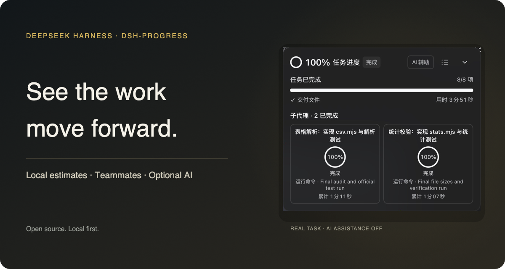
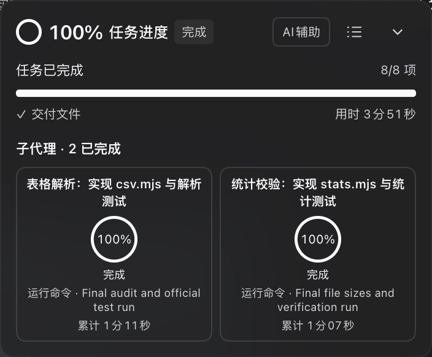
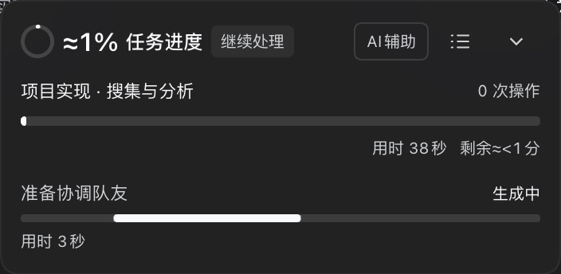
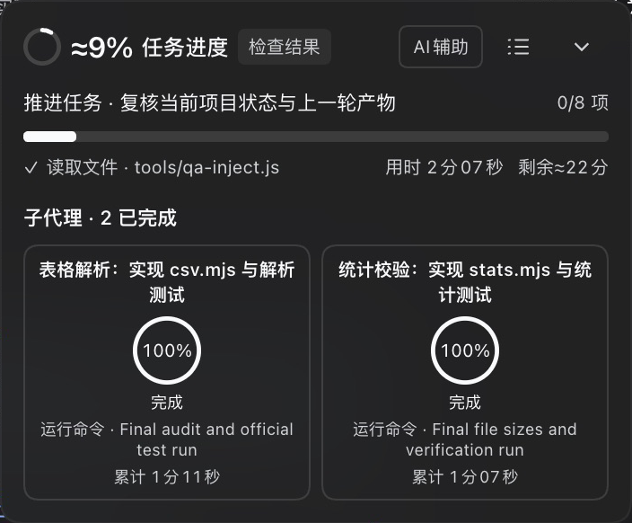
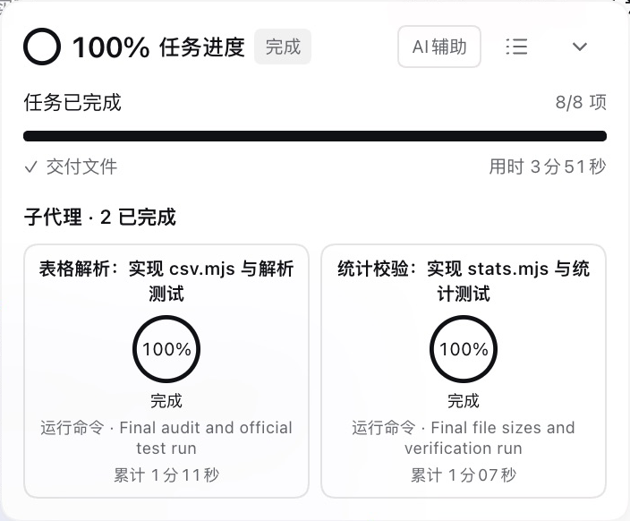
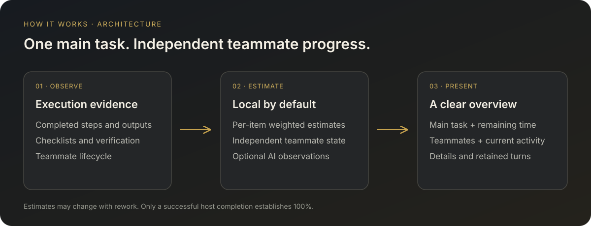
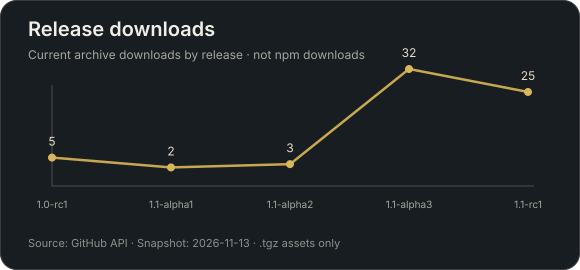
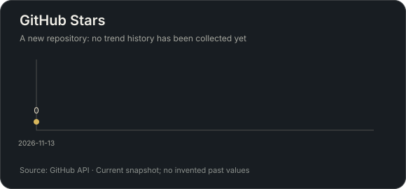

<h1 align="center">dsh-progress</h1>
<p align="center">See the work move forward.</p>
<p align="center">Local estimates · Teammate progress · Optional AI</p>
<p align="center"><a href="#install">Install</a> · <a href="README.zh-CN.md">中文</a> · <a href="https://github.com/HimLeoing/dsh-progress/releases">Releases</a></p>



A task progress panel for [DeepSeek Harness](https://github.com/deepseek-ai/deepseek-harness) Web. See approximate percentages, current operations, and estimated remaining time, even with AI assistance off.

| From request to delivery | From lead to teammates | From overview to detail |
| --- | --- | --- |
| Estimates informed by steps, checklists, and verification. | Main task progress stays visible; each teammate has independent state. | Drag or collapse the panel, and open details when needed. |

## In use

These are screenshots from real task execution.

| Start | In progress | Complete |
| --- | --- | --- |
|  |  |  |

| Dark | Light |
| --- | --- |
|  |  |

## How it works



## Project activity

| Release archive downloads | Star observations |
| --- | --- |
|  |  |

Snapshot: 2026-11-13. npm publication is pending, so the left chart counts GitHub .tgz downloads. Star history has not been sampled yet; no historical curve is invented.

## Requirements

| Component | Supported version |
| --- | --- |
| DeepSeek Harness | **`>=0.2.2-rc.1`**, Web profile; tested on `0.2.2-rc.3` |
| Node.js | **`>=24.9.0`** |
| Probe cost estimates | Built in; no additional plugin required |

The package declares the host version in `engines.dsh`. The minimum range includes later prereleases. Desktop and TUI are not supported. A future breaking host API can still require a plugin update.

## Install

Install the release archive in the Web profile:

```sh
dsh plugin --profile web add "https://github.com/HimLeoing/dsh-progress/releases/download/v0.1.1-rc2/dsh-progress-0.1.1-rc2.tgz"
```

Or install the tagged source:

```sh
dsh plugin --profile web add "github:HimLeoing/dsh-progress#v0.1.1-rc2"
```

Enable the bundle in **Plugins**, restart the host, and reload the Web UI. The package ships its runtime files; no build, install script, or additional runtime dependency is required.

**Upgrading from Alpha3:** its older in-panel updater compares exact host strings and cannot accept this release’s minimum-version range. Install the current release once through the official CLI or market. Current releases support declared ranges.

Repository topic: `dsh-plugin`. The plugin is listed in the community market. Prerelease archives are pinned in the catalog: a GitHub release alone does not update that install link; the existing entry must also be updated. The panel’s RC updater checks GitHub independently.

## Progress

The panel follows the turn you are reading. Scroll or use the conversation turn navigator to inspect an earlier turn; return to the bottom for the live turn. Retained history is bounded, and an unavailable turn is identified explicitly. A step is a completed agent execution boundary. It is not a known fraction of the total work.

| Evidence | Display |
| --- | --- |
| Complete checklist, AI disabled | Weighted local estimates for each active item |
| No complete checklist, AI disabled | An approximate local percentage, marked `≈` |
| AI enabled with enough evidence | An approximate percentage, marked `≈` |
| Teammates running | Independent compact cards; open a card for that teammate's progress |
| Authoritative successful turn end | `100%` |
| Interruption, failure, or connection loss | An explicit state; never treated as successful completion |

The main turn includes the lead's integration, verification, and delivery. A delegated checklist or a group of completed teammates cannot establish that the main request is finished. The main percentage is not an average of teammate percentages.

Local estimates work on a fresh installation. Task-type priors and completed execution evidence are primary; bounded comparable-work history is only a small refinement. A running turn without a checklist starts with a conservative approximate number and does not wait for historical samples. Waiting and repeated background-output polls do not advance overall progress. Material size supplies bounded work credit; identical observed writes are counted once. Syntax checks, substantive tests, and observed test totals carry different evidence. A draft preview alone cannot establish delivery. New material invalidates earlier verification, and a successful substantive recheck clears outstanding rework debt without erasing failure history. Reading or checking a small fragment cannot establish that a build is nearly complete. Rework can reduce the estimate. Cold-start and unfamiliar tasks can still have substantial estimation error.

For a complete checklist, weights are frozen for its current scope. Explicit weights or valid AI weights take precedence; otherwise task difficulty is estimated locally. Each item has its own evidence and prior: `overall = sum(weight × item progress)`. For example, `20% + 40% × 60% = 44%`. Pending items contribute zero, and the next item starts with its own evidence. AI observations can refine item fractions when enabled. Pending items contribute nothing; an unfinished item cannot consume its full weight. Rework and scope changes can reduce or invalidate an estimate.

Verification, delivery, and teammate completion receive priority when supported by execution evidence. There is **no 90% ceiling**, no automatic climb through the nineties, and no automatic completion based on elapsed time. A final step can still move an estimate directly to `100%` when the turn actually ends. During text output, completed checklists or verified delivery evidence can qualify a reversible `≈99%` “Writing response” state. DSH does not expose a final-answer-start marker, so this is an estimate: another tool call or rework restores execution progress. Only successful turn completion establishes `100%`.

The panel is draggable and collapsible. Task details show the checklist when available, probe diagnostics, and a horizontally scrollable trend. Hover or focus a point to inspect its progress and source teammate.

## Optional AI observations

AI assistance is **disabled by default**. Enable it in the panel header. An enabled button has an accent border and text.

Observations use the current session's selected provider and **Off reasoning**. Off is not free: requests still consume input, cached-input, and output tokens. When the provider does not advertise Off, the model’s lowest advertised reasoning level is used. Models without reasoning controls use their native default; the plugin does not invent unsupported options.

Three observation modes are available:

- **Smart balanced:** merge ordinary boundaries; prioritize changes such as failures, rework, checklist changes, verification, and teammate lifecycle events.
- **Every other step:** merge ordinary boundaries in pairs, retaining critical-event priority.
- **Every step:** observe each eligible completed step for finer feedback.

No new boundary means no new automatic request. Reading the panel or waiting does not trigger a timed probe. There is no hourly request quota; requests are serialized and queues are bounded. More detailed observation can cost more.

While AI remains enabled, an aged estimate can be retained during ordinary same-scope execution until its replacement arrives. The retained state is not a new AI observation; failures, rework, changed scope, or resumed teammate turns invalidate it. A fresh lower estimate remains allowed.

Turning AI off removes unsent work. An already-sent request may still finish to collect usage, but a response from an old configuration cannot update current progress. Changing modes does not backfill old steps.

When a complete checklist exists, turning AI off can freeze the last valid AI estimate and the remaining item weights. New local item evidence advances only the portion remaining after that checkpoint; previously counted work is excluded. Actual item completion contributes its full remaining weight. Scope changes, reopened work, or changed ownership invalidate this checkpoint. Without a complete checklist, the panel uses its independent local estimate and keeps a gray historical AI reference. Re-enabling AI preserves the local checkpoint while awaiting a new valid observation.

**Estimate once** waits for an eligible execution boundary. With automatic AI disabled, it provides one diagnostic observation and does not replace local progress.

## Estimated remaining time

The overall timer uses `(1 / progress - 1) × elapsed`, where progress is a fraction. A changed progress estimate or relevant evidence creates a new timer anchor; ordinary polling does not restart it. Rework can increase the estimate.

With AI assistance enabled, remaining time counts down in seconds. With AI disabled, it is shown in whole minutes, or `≈ <1m` below one minute. A running timer keeps a positive lower bound; it never declares completion. Successful completion and interruption hide the timer. Teammate estimates use the current turn’s elapsed time, even when the card shows cumulative work time.

If the browser bundle and backend versions differ, task details identify the mismatch and recommend restarting the host. A conservative client fallback keeps overall progress numeric while a backend reload is pending; it does not copy the current command’s progress.

## Command progress

Tool activity is separate from overall task progress. A command can have a useful remaining-time estimate even when the turn's total work is unknown.

- Explicit counters, frame totals, supported FFmpeg progress, complete tqdm meters, and the native producer progress channel can provide measured progress.
- A standalone literal delay can use its declared duration. Historical timing requires enough samples for the same command and a sufficiently narrow distribution.
- Unknown or ambiguous commands use an activity bar. An expired timing estimate does not restart its countdown.
- Recognized long-running services display `∞`. A background job is not automatically a permanent service.
- Reaching a reported total is not proof of process success: finalization can remain, and exit status is authoritative.

The observer uses the native job registry's non-consuming output offsets. It does not advance the model's output cursor, stop processes, or send a model request to estimate command duration. Complex output formats and commands without an observable total remain unknown.

## Costs and local data

The **Probe cost ≈** tile sums progress-observation requests from the main turn and its teammates. It excludes the models' work on the project itself. A teammate detail shows that teammate's probe cost.

Probe pricing is built in; no additional plugin is required. It handles separate cache buckets, historical prices, peak schedules, and exchange rates without balance or quota requests. The bundled DeepSeek CNY price snapshot was checked on **2026-11-11** against the [official pricing page](https://api-docs.deepseek.com/quick_start/pricing/). Other providers use the bundled catalog; USD-to-CNY estimates use a configurable reference rate (default 7.2), not a live FX quote. Unknown gateways or models stay unpriced.

Optional `pricing.json` in the plugin data directory overrides the price configuration; otherwise an existing cost-meter ledger can supply read-only prices and history. With neither file present, bundled prices are used. See [third-party notices](THIRD_PARTY_NOTICES.md). A `+` means some requests lack usage or pricing: the displayed amount is a known subtotal. `—` means no usable estimate is available. A failed or discarded request can still be billed. Previously unpriced requests with complete usage can be recovered from retained logs; already priced amounts remain frozen, and incomplete history does not erase known costs.

Local state is stored below `$DSH_HOME/dsh-progress/`, or `~/.dsh/dsh-progress/` by default:

- `preferences.json`: AI settings, observation mode, and the developer-mode switch.
- `progress.json`: bounded turn snapshots and checklist summaries.
- `learning.json`: bounded local timing and anonymous work-profile history.
- `probes.jsonl` and its rotated predecessor: request metadata, usage, and diagnostic outcomes.

Normal probe logs contain metadata only. Developer mode is off by default. Its footer button is accented when enabled; the fixed-height log viewer scrolls without expanding the panel. While enabled, `probe-debug.jsonl` records actual LLM-service inputs, output chunks, call times, errors, and usage for the main turn and teammates. Open or export these records from task details. These local logs may contain request content and model reasoning; they are not provider HTTP captures and do not add credentials. Two rotating files are capped at 5 MiB each; oversized payloads are marked truncated. Earlier raw content cannot be reconstructed by enabling the switch later. Optional AI observations send a bounded summary of the current request and execution evidence to the selected provider.

On first use, eligible legacy progress data can be copied into the new directory. Existing destination files win; originals are not deleted. Browser panel position and collapse preferences also migrate when the new keys are absent.

## Plugin updates

Task details show the loaded version at the bottom right. The updater verifies the published SHA-256 checksum, validates the host requirement, uses the official profile installer, and restarts the same Web host. Updates wait for running tasks to finish. Normal mode checks newer RC releases; developer mode also checks newer Alpha releases. The circular footer button appears only when an eligible release exists. Confirming installation warns that DSH will restart.

## Development

Use a source checkout with the required Node.js version:

```sh
npm test
npm pack --dry-run
```

Tests use controlled clocks, providers, and host services. They check behavior and billing consistency; they do not prove that an LLM percentage matches true work remaining. Do not use real credentials, paid model requests, or personal project logs in tests.

See [CONTRIBUTING.md](https://github.com/HimLeoing/dsh-progress/blob/main/CONTRIBUTING.md), [CHANGELOG.md](CHANGELOG.md), and the [MIT license](LICENSE).
