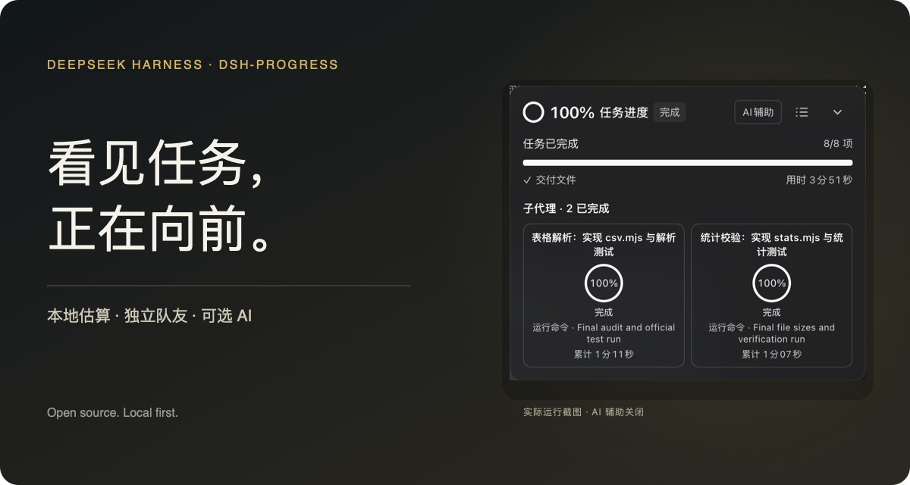
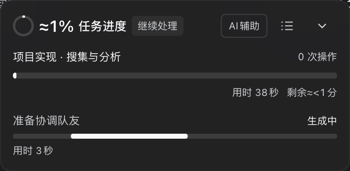
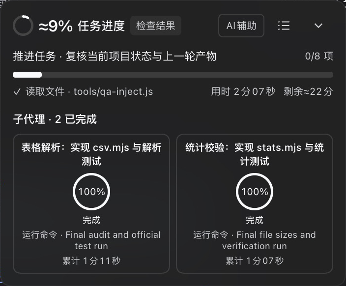
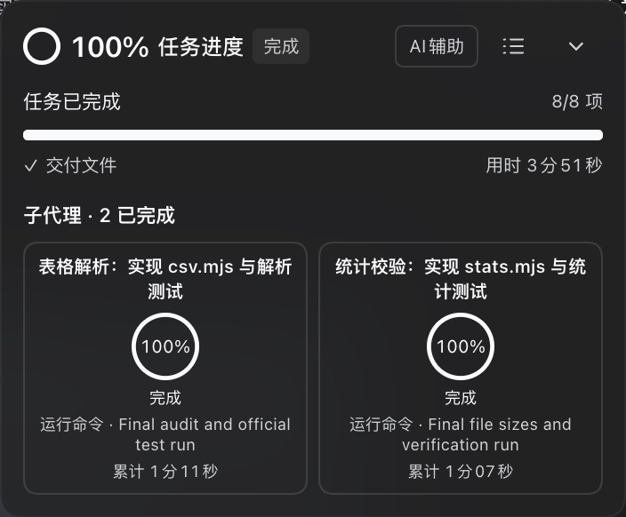
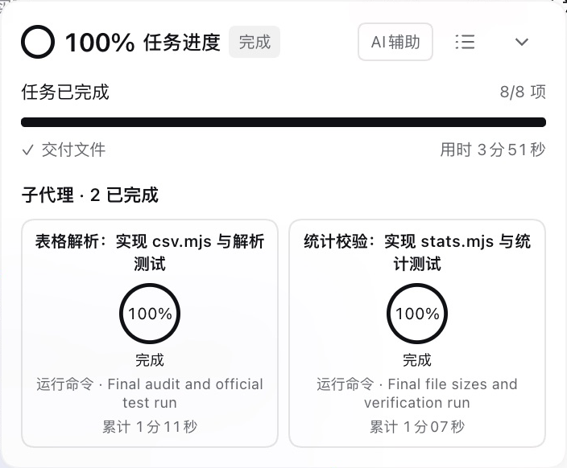
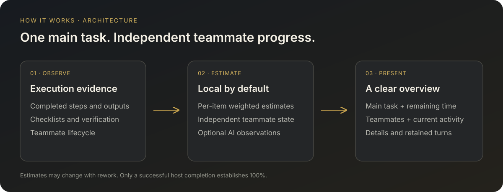
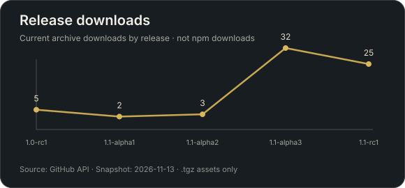
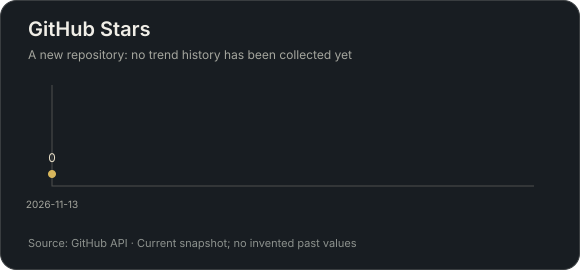

<h1 align="center">dsh-progress</h1>
<p align="center">看见任务，正在向前。</p>
<p align="center">本地估算 · 队友进度 · 可选 AI 辅助</p>
<p align="center"><a href="#安装">安装</a> · <a href="README.md">English</a> · <a href="https://github.com/HimLeoing/dsh-progress/releases">发布记录</a></p>


为 [DeepSeek Harness](https://github.com/deepseek-ai/deepseek-harness) 网页版提供一个清晰的任务进度面板。不打开 AI 辅助，也能看到本地估算百分比、正在执行的操作和剩余时间。

| 从任务到交付 | 从主代理到队友 | 从概览到细节 |
| --- | --- | --- |
| 观察步骤、清单与验证结果，显示估算进度。 | 主任务持续显示，每个队友有独立进度。 | 面板可以拖动、折叠，详情按需展开。 |

## 实际运行

以下均为真实任务运行截图。

| 开始 | 进行中 | 完成 |
| --- | --- | --- |
|  |  |  |

| 深色 | 浅色 |
| --- | --- |
|  |  |

## 如何工作



## 项目统计

| GitHub 安装包下载量（按版本） | Star 记录 |
| --- | --- |
|  |  |

统计快照：2026-11-13。npm 尚未发布，因此左图统计 GitHub 的 .tgz 下载量；Star 尚无历史采样，不补造曲线。

## 宿主要求

| 组件 | 支持版本 |
| --- | --- |
| DeepSeek Harness | **`>=0.2.2-rc.1`，Web profile；已验证 `0.2.2-rc.3`** |
| Node.js | **`>=24.9.0`** |
| 探针费用估算 | 已内置，无需额外插件 |

`package.json` 通过 `engines.dsh` 声明宿主版本。最低版本范围包含后续预发布版本。不支持 Desktop 或 TUI。未来宿主若出现破坏性接口变更，仍可能需要更新插件。

## 安装

将 Release 安装包添加到 Web profile：

```sh
dsh plugin --profile web add "https://github.com/HimLeoing/dsh-progress/releases/download/v0.1.1-rc2/dsh-progress-0.1.1-rc2.tgz"
```

也可按 Git tag 安装源码：

```sh
dsh plugin --profile web add "github:HimLeoing/dsh-progress#v0.1.1-rc2"
```

在**插件**页面启用 bundle，重新启动宿主并重新加载 Web 页面。安装包已包含运行文件，无需构建、安装脚本或额外运行时依赖。

**从 Alpha3 升级：**旧版面板更新器按宿主精确字符串校验，无法接受 RC1 的最低版本范围。请先通过官方安装命令或市场安装一次当前版本；新版面板更新器已支持版本范围。

仓库带有 `dsh-plugin` topic，已收录至社区市场。预发布安装包在市场目录中使用固定链接，单独发布 GitHub Release 不会替换该链接；需要更新原条目。面板内的 RC 更新器独立检查 GitHub。

## 任务进度

面板跟随**正在阅读的轮次**。滚动或通过对话右侧轮次导航回看历史，回到底部则显示当前任务。历史记录有保留上限，缺失的轮次会明确标记。步骤是智能体一次执行结束的边界，步骤数并不是已知总工作量。

| 可用依据 | 展示 |
| --- | --- |
| 有完整清单，AI 关闭 | 每项独立进行本地估算，再按固定权重累计 |
| 无完整清单，AI 关闭 | 带 `≈` 的本地估计百分比 |
| AI 开启且依据足够 | 带 `≈` 的估计百分比 |
| 队友正在运行 | 独立的紧凑卡片，点击进入该队友详情 |
| 本轮真实成功结束 | `100%` |
| 中断、失败或连接断开 | 明确标记状态，不当作成功完成 |

主任务还包含主代理的整合、验证和交付。分工清单全部完成、所有队友结束，都不能单独证明主任务已经完成。主百分比不是各队友百分比的平均值。

本地估计无需历史记录即可运行，以任务类型先验和真实完成的操作证据为主，同类成功任务的有界历史只作小修正。无清单的运行任务从保守的估计数字开始，不会等待历史样本才显示百分比。单纯等待、重复读取后台输出不会推动总进度；实际修改、有效检查与交付会更新估计，返工可以使估计回退。冷启动和陌生任务仍可能有较大误差。

有完整清单时，在当前范围内冻结权重，优先采用明确权重或有效 AI 权重，否则按本地难度规则估重。每项独立记账，按 `总进度 = Σ(任务权重 × 项内进度)` 累计，例如 `20% + 40% × 60% = 44%`。下一项从自己的证据起算。开启 AI 后可进一步评估项内进度。待处理项不贡献进度；未完成项不能占满自己的权重。返工与范围变化会使旧估计下降或失效。

有执行证据支持的验证、交付和队友完成节点优先评估。**没有 90% 封顶规则**，不会自动补出九十多的数字，也不会仅因时间流逝自动完成任务。真实结束时，最后一步仍可能从较低估计直接到 `100%`，不会为了平滑曲线制造中间值。

面板可拖动、可收起。“任务详情”直接展示清单（如有）、探针诊断和可横向滚动的趋势图。鼠标悬停或键盘聚焦小点，可查看对应进度和来源队友。

输出文字时，完整清单完成或验证、交付依据充分，可进入可撤回的 `≈99%`“正在输出答复”。宿主没有明确的最终答复开始信号；再次调用工具或返工时恢复执行进度。只有真实成功结束才显示 `100%`。

本地算法按实际产出量计入有上限的证据，相同内容的重复写入只计一次；宿主未提供内容时不会擅自认定重复。语法检查、实质测试和真实测试结果采用不同证据强度。草稿预览不能单独证明即将交付，新增修改使旧验证失效，通过重新测试后解除待修复扣分，失败历史仍保留。只阅读文件或检查一个片段，不能证明整个开发任务已接近完成。

## 可选 AI 评估

AI 辅助**默认关闭**，可在面板标题栏开启。开启后按钮文字与边框使用强调色。

评估使用当前会话所选提供方的 **Off 推理档**。Off 不代表免费，输入、缓存输入和输出仍可能计费。提供方不明确支持 Off 时，将使用模型最低强度档位。不提供推理档控制的模型使用其原生默认配置，不传入不支持的选项。

可选择三个节奏：

- **智能均衡**：合并普通步骤，失败、返工、清单变化、验证和队友生命周期等关键证据优先。
- **隔步省费**：普通节点两步合并，仍保留关键节点优先。
- **逐步精细**：每个符合条件的步骤结束后评估，反馈更细。

没有新执行边界就没有新的自动请求。读取面板和单纯等待不会按秒触发探针。不设小时调用配额；请求串行执行，队列有界。更密集的观察可能产生更多费用。

AI 保持开启时，同一范围内的普通执行变化可暂时保留上次有效估计，等待新结果；它不算新的 AI 观察。失败、返工、范围变化或队友续接会使旧值失效，新评估也可以给出更低进度。

关闭 AI 会清除未发送队列。已发送请求可继续收集最终用量，但旧配置下的响应不能覆盖当前进度。切换节奏不会补发历史步骤。

有完整清单时，关闭 AI 可冻结最后有效 AI 百分比及剩余项权重，随后按**关闭之后新增的项内本地进度**分配剩余区间，扣除已经计入的贡献；真实完成项占满其剩余权重。范围、认领、依赖或返工发生变化时，旧检查点失效。没有完整清单时使用独立的本地百分比，并将上次 AI 数字保留为灰色历史参考。重新开启后，在新评估返回前保留当前本地衔接值。

“单次估计”也等待可用执行边界；自动 AI 关闭时，它只提供一次诊断参考，不替换本地进度。

## 预估剩余时间

总倒计时使用 `(1 / 当前进度 - 1) × 已用时间`，进度按小数计算。进度估计或有效证据变化时重新建立计时起点；普通刷新不会把同一次倒计时重新拉长。返工可以上调估时。

开启 AI 时按秒递减；关闭 AI 时统一按分钟显示，小于一分钟显示 `剩余≈<1分`。运行中的计时保留正数底限，不会倒到0或因此宣告完成；任务完成或中断后隐藏。子代理用当前轮次的实际用时估算，卡片仍可显示多轮累计用时。

浏览器模块与后端版本不一致时，任务详情会标明版本并提示重启宿主。等待后端重载期间，客户端也会保留保守的主任务数字估计，不复制当前命令的小进度。

## 命令小进度条

工具活动与整个任务的完成度分别计算。即使不知道整个轮次还剩多少工作，也可能知道一条命令的剩余时间。

- 明确计数、帧数总量、支持的 FFmpeg 输出、完整 tqdm 进度和原生生产者进度可提供可观测完成量。
- 独立的字面量延时命令使用声明时长。历史估时要求同一命令有足够样本且分布足够集中。
- 未知或有歧义的命令使用活动条；时长估计过期后不会重新启动倒计时。
- 能识别的常驻服务显示 `∞`。后台运行不等于常驻服务。
- 报告计数达到总量仍可能需要收尾，不能替代进程成功退出的依据。

观察器使用原生任务注册表的独立输出偏移，不消耗模型读取游标、不停止进程，也不为命令时长额外调用模型。复杂格式或没有可观测总量的命令保持未知。

## 费用与本地数据

“本轮费用 ≈”合计本轮主任务及所有队友的**进度评估请求**，不包含它们执行项目本身的模型费用。队友详情显示该队友的探针费用。

探针计价已内置，无需安装额外插件。支持互斥缓存桶、历史价格、峰谷时段与汇率，不查询余额或额度。内置 DeepSeek 人民币价格于 **2026-11-11** 对照[官方价格页](https://api-docs.deepseek.com/zh-cn/quick_start/pricing/)核对；其他提供方使用内置目录，美元换算人民币默认参考汇率 7.2，可配置覆盖，并非实时汇率。未知网关或模型不擅自套价。

可用插件数据目录下的 `pricing.json` 覆盖价格配置；没有该文件时，可只读采用已有 cost-meter 账本的价格与历史。两个文件都不存在时，直接使用内置价格。参见[第三方许可](THIRD_PARTY_NOTICES.md)。金额后的 `+` 表示部分调用缺少用量或价格，显示的是已知小计；`—` 表示没有可用估算。失败或未采用的响应也可能已经产生费用。保留的日志若有完整用量，可补算以前未计价的请求；已计价金额保持冻结，历史不完整时也不会清空已知费用。

数据保存于 `$DSH_HOME/dsh-progress/`，默认是 `~/.dsh/dsh-progress/`：

- `preferences.json`：AI 开关、范围、节奏与开发者模式。
- `progress.json`：有界的轮次状态与清单摘要。
- `learning.json`：有界的本地耗时与匿名工作量样本。
- `probes.jsonl` 及上一份轮转日志：请求元数据、用量与诊断结果。

普通探针日志仅保存元数据。开发者模式默认关闭；详情底栏的按钮开启时变黄，固定高度的日志框可上下滚动，不撑高面板。开启期间，`probe-debug.jsonl` 会记录主代理和队友的实际 LLM 服务输入、输出流、调用时间、错误与用量，可从任务详情查看或导出。这些本地记录可能含请求正文和模型推理，不是提供方的 HTTP 抓包，也不会额外加入凭据。日志轮换为两份，每份最多 5 MiB；超长内容会标记截断。开启前的原始内容无法补录。开启 AI 时，会把当前请求和执行证据的受限摘要发送给所选提供方。

首次运行可将符合条件的旧进度数据复制到新目录，已有目标文件优先，原文件不会删除。新浏览器键不存在时，也会迁移旧面板的位置与收起偏好。

## 插件更新

任务详情右下角显示实际加载版本。更新器核验发布的 SHA-256、检查宿主要求，通过官方配置安装器更新，并重启原 Web 宿主。有任务运行时暂不更新。普通模式检查更新的 RC；开启开发者模式后也检查更新的 Alpha。符合条件的新版本出现时，版本号左侧才显示圆形更新按钮，确认安装时会提示重启 DSH。

## 开发与反馈

使用满足要求的 Node.js，在源码目录运行：

```sh
npm test
npm pack --dry-run
```

测试使用受控时钟、提供方与宿主服务，验证行为和计费一致性，不能证明 LLM 百分比等于真实剩余工作量。不要将真实凭据、付费请求或个人项目日志加入测试。

参见 [贡献说明](https://github.com/HimLeoing/dsh-progress/blob/main/CONTRIBUTING.md)、[更新记录](CHANGELOG.md) 和 [MIT 许可证](LICENSE)。
