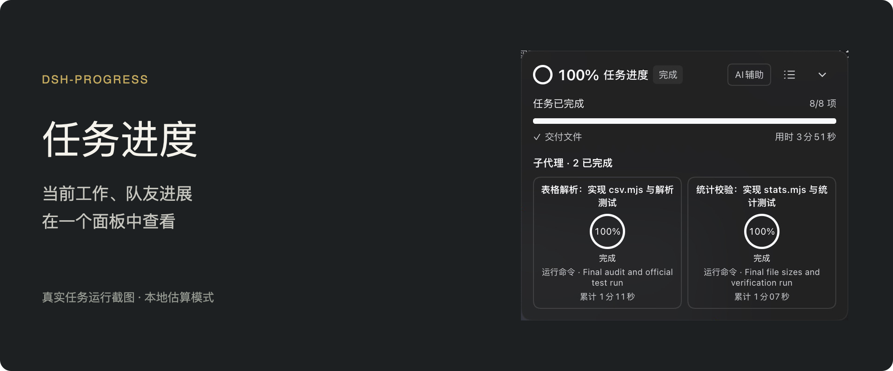

# See the work move forward

dsh-progress adds a draggable task progress panel to DeepSeek Harness Web. See where the current task stands, what is running, and how each teammate is doing.

## What it shows

- **Overall progress:** local percentages and estimated remaining time, even with AI assistance off. No extra model requests are required for local estimates.
- **Current activity:** reads, writes, and commands have their own activity display. Observable totals provide measured progress.
- **Teammates:** independent cards show names, progress, and current operations. Open a card for that teammate's details.
- **Earlier turns:** follow the conversation turn you are reading and revisit its retained progress.
- **Details on demand:** checklists, trends, and costs live in task details. Developer mode adds observations and probe logs.

## Optional AI assistance

Disabled by default. When enabled, observations use the current session's provider and prefer Off reasoning. If Off is unavailable, the model's lowest supported level is used. Input, cached input, and output can still be billed. The panel totals progress-probe costs for the lead and teammates; it excludes the models' work on the project itself.

Percentages and remaining time are estimates. Rework, scope changes, or further verification can reduce progress or increase remaining time. Only authoritative successful completion establishes 100%.

## Requirements

- DeepSeek Harness **>=0.2.2-rc.1**, Web profile.
- Node.js **>=24.9.0**.
- Local estimation and probe pricing are built in. No additional plugin is required.

Enable the installed plugin, restart Harness, and reload the Web UI. Eligible legacy data is copied when destination files are absent; originals remain intact.

[Screenshots, documentation, and releases](https://github.com/HimLeoing/dsh-progress)
