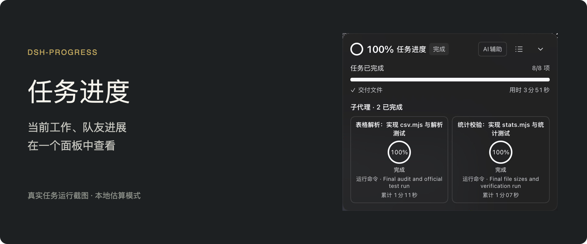

# 看见任务，正在向前

dsh-progress 为 DeepSeek Harness 网页版提供一个可拖动的任务进度面板。查看当前任务进行到哪一步、正在执行什么，以及队友各自的进展。

## 你能看到什么

- **主任务进度**：AI 辅助关闭时也有本地估算百分比与剩余时间，不需要额外模型请求。
- **当前操作**：读取、写入、命令等活动单独展示；有可观测总量时显示确定进度。
- **队友进度**：独立卡片显示名字、进度和当前操作，点击查看该队友的任务详情。
- **历史轮次**：跟随正在阅读的对话轮次，回看之前的任务进度。
- **按需展开**：任务清单、趋势和费用放在详情中；开发者模式提供进一步的诊断与探针日志。

## 可选 AI 辅助

默认关闭。开启后使用当前会话的提供方进行评估，优先使用 Off 推理强度；不支持时采用模型最低可用强度。评估仍可能产生输入、缓存输入与输出费用。面板汇总主代理和队友的进度探针费用，不含项目本身的模型费用。

百分比和剩余时间都是估计。返工、增加任务或重新验证可能使进度回退或剩余时间增加。只有宿主确认任务成功结束，才显示 100%。

## 使用要求

- DeepSeek Harness **>=0.2.2-rc.1**，Web profile。
- Node.js **>=24.9.0**。
- 本地估算和探针费用计算均已内置，无需安装其他插件。

安装后启用插件，重启 Harness 并刷新网页。旧版任务进度数据在目标文件不存在时迁移，原文件保留。

[查看截图、使用说明与发布记录](https://github.com/HimLeoing/dsh-progress)
